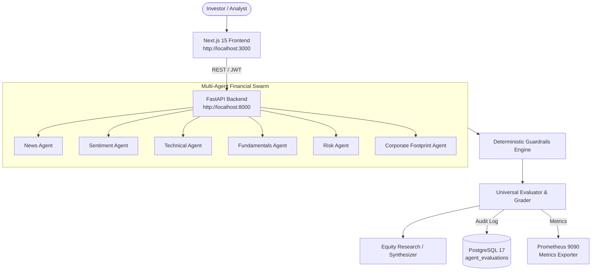

# MarketPulse — Product & Technical Overview

MarketPulse (formerly *FinnWinn*) is an AI-powered financial intelligence and equity analysis platform designed to turn raw market noise into actionable, institutional-grade equity research reports.

Instead of relying on a single monolithic prompt, MarketPulse coordinates **six specialized AI domain agents** plus a **Portfolio Synthesizer**, equipped with **deterministic anti-hallucination guardrails**, **contradiction radar**, **vector semantic search**, and **Prometheus/PostgreSQL telemetry**.

---

## 🌟 What the Application Does

When a user searches for a publicly traded stock (e.g., `AAPL`, `NVDA`, `TSLA`):

1. **Autonomous Parallel Analysis**: Six AI agents analyze the ticker from different angles concurrently:
   - 📰 **News Agent**: Fetches real-time financial news headlines via NewsAPI, filtering out noise and summarizing top market catalysts.
   - 📊 **Sentiment Agent**: Analyzes news sentiment, analyst revisions, and market tone to generate a unified sentiment score ($1-10$).
   - 📈 **Technical Agent**: Evaluates price momentum, moving averages (SMA 20/50/200), RSI, and key support & resistance zones.
   - 🏢 **Fundamentals Agent**: Computes core valuation ratios (P/E, P/S, EV/EBITDA, Debt-to-Equity, operating margins) and tags the stock as `undervalued`, `fairly_valued`, or `overvalued`.
   - 🛡️ **Risk Agent**: Gauges volatility, calculates 95% Value at Risk (VaR), Beta, and Sharpe ratios, assigning an overall risk classification (`low`, `medium`, `high`).
   - 🔍 **Corporate Footprint Agent**: Runs an autonomous multi-turn research loop querying SEC EDGAR filings, Wikipedia, and search engines to analyze corporate ownership, legal footprint, and ESG factors.
2. **Portfolio Synthesizer**: Merges all domain analyses into a unified institutional recommendation (`buy`, `sell`, or `hold`) with price targets and a conviction rating ($1-10$).
3. **Contradiction Radar**: Automatically detects and flags conflicting signals (e.g., *Bullish Technical Breakout vs. Overvalued Fundamentals*) so investors see hidden risks before placing trades.
4. **Anti-Hallucination Guardrails & Audit**: Every agent output passes through mathematical and sanity guardrails. Results are scored for **Faithfulness**, **Consistency**, and **Completeness** (Letter grade `A` to `FAIL`) and persisted to PostgreSQL.
5. **Interactive Frontend Dashboard**: Next.js 15 web UI featuring:
   - Live ticker search with auto-complete.
   - Watchlist drawer for saving favorite assets.
   - Comprehensive multi-tab analysis view with radar charts and quality badges.
   - Prometheus and token consumption monitoring.

---

## 🏗️ Architecture & Technology Stack



### Stack Breakdown

| Layer | Technologies Used |
| :--- | :--- |
| **Frontend** | Next.js 15 (App Router), React 19, Tailwind CSS v4, CSS Modules, Context API |
| **Backend** | Python 3.10/3.12, FastAPI, Pydantic, asyncio concurrent fan-out |
| **LLMs & Intelligence** | Groq (`llama-3.3-70b-versatile`), Mistral AI, Google Gemini |
| **Data Providers** | NewsAPI, yfinance, SEC EDGAR API, DuckDuckGo Search |
| **Vector Search** | Pinecone (`marketpulse` index, 384 dimensions) with Hugging Face embeddings |
| **Database** | PostgreSQL 17 (`ThreadedConnectionPool`) storing users, watchlists, token logs, and evaluation audits |
| **Observability** | Prometheus (Docker container scraping `/metrics`), native FastAPI instrumentator |

---

## 🛡️ Anti-Hallucination Guardrails & Evaluation

To ensure financial safety, agents do not output unchecked LLM responses directly:

- **News Guardrail**: Drops dead links, checks URL reachability, removes synthetic placeholders (`theme1`, `risk1`).
- **Technical Guardrail**: Enforces $Support \le Resistance$ and prevents impossible breakout claims.
- **Fundamentals Guardrail**: Cross-checks P/E ratios and financial bounds against reported revenue and earnings.
- **Sentiment & Risk Guardrails**: Clamps scores strictly within $[1, 10]$ and aligns qualitative statements with mathematical indicators.
- **Evaluation Engine**: Rates every report on Faithfulness, Completeness, and Consistency, assigning a letter grade (`A`, `B`, `C`, `FAIL`).

---

## 🚀 Getting Started

### 1. Prerequisites
- Node.js 18+ and Python 3.10+
- PostgreSQL 17 running on port `5432`
- Docker Desktop (for Prometheus)

### 2. Starting the Application

#### Backend (FastAPI):
```powershell
cd d:\Web_dev\MarketPulse\market-pulse\backend
.\venv\Scripts\uvicorn.exe main:app --reload --host 0.0.0.0 --port 8000
```

#### Frontend (Next.js):
```powershell
cd d:\Web_dev\MarketPulse\market-pulse
npm run dev
```

#### Prometheus Monitoring (Docker):
```powershell
docker run -d --name marketpulse-prometheus -p 9090:9090 -v D:\Web_dev\MarketPulse\market-pulse\prometheus.yml:/etc/prometheus/prometheus.yml prom/prometheus
```

---

## 🔑 Default Test Accounts

| Email | Password | Role |
| :--- | :--- | :--- |
| `demo@marketpulse.com` | `password123` | Default Test User |
| `test@test.com` | `password123` | Secondary Test User |

*(Or register a new account anytime at [http://localhost:3000/register](http://localhost:3000/register))*

---

## 🌐 Quick Links & Endpoints

| Resource | URL |
| :--- | :--- |
| **Frontend Web App** | [http://localhost:3000](http://localhost:3000) |
| **Interactive API Documentation** | [http://localhost:8000/docs](http://localhost:8000/docs) |
| **Prometheus Metrics Explorer** | [http://localhost:9090](http://localhost:9090) |
| **Multi-Agent Evaluation Analytics** | [http://localhost:8000/evaluations/agents/summary](http://localhost:8000/evaluations/agents/summary) |
| **Token Consumption & Latency Logs** | [http://localhost:8000/tokens/summary](http://localhost:8000/tokens/summary) |
| **Prometheus Metrics Target** | [http://localhost:8000/metrics](http://localhost:8000/metrics) |
| **QA Task Tracker** | [`QA_TASKS.csv`](./QA_TASKS.csv) |
| **Tester & UI/UX Communication Log** | [`TESTER_COMMUNICATIONS.md`](./TESTER_COMMUNICATIONS.md) |
